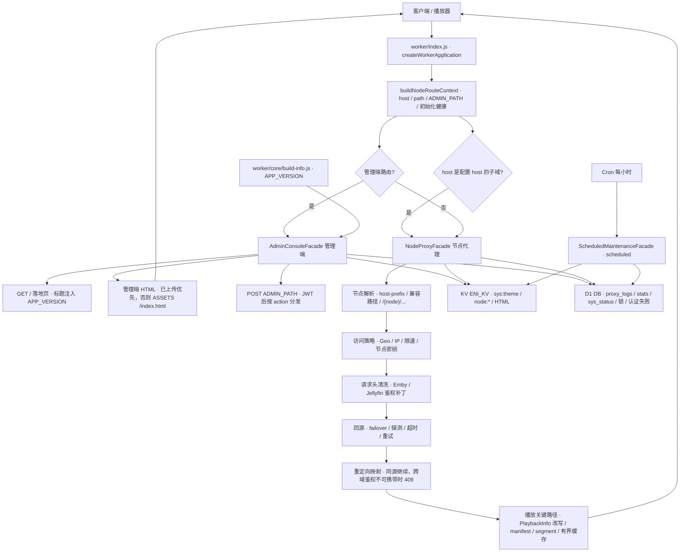

# 当前项目架构

## 1. 总体形态

项目由一个 Cloudflare Worker 和一个同源管理端组成。Worker 是边缘运行时和唯一服务端入口；管理端 HTML 可以是仓库内模板组合出来的本地版本，也可以由 Worker 从配置的远端/已上传版本投递。两者通过管理动作 API 通信。



图 1 是端到端运行时总览：`fetch` 与 `scheduled` 两个入口、控制面（管理端与路由）和数据面（节点代理）的分工，以及 KV / D1 两个持久化边界。第 3、4 节展开请求生命周期与管理端投递链，第 8 节给出设置项与绑定/键的对应关系。

## 2. Worker 源码分层

### 入口与组合

- `worker/index.js` 只调用 `createWorkerApplication()` 并默认导出 `workerHandler`。
- `worker/runtime/application-facades.js` 是当前组合模块。它使用 `//#region` 保留按功能域组织的实现，并在末尾组装 `AdminConsoleFacade`、`NodeProxyFacade`、`ScheduledMaintenanceFacade`。
- `createWorkerApplication()` 创建 kernel、缓存管理器、日志器、管理端 shell、代理 workflow 和定时维护服务，然后返回冻结的 handler。
- `scripts/check-worker-architecture.mjs` 将 `application-facades.js` 作为当前已知的 facade 例外，同时检查依赖方向、单入口、无动态 import、无遗留通用 operation bag。检查器不限制 facade 的总行数，真正的预算是每个 `//#region` 不超过 1800 行（`facadeRegionMaxLines`）；非 facade 模块另有 1500 行上限（`defaultModuleMaxLines`）。

### 可独立阅读的目录

- `worker/core/`：`http-body`（有界请求/响应体）、`bounded-json`、`hashing`、`primitives`、`binding-state` / `runtime-binding-state`、`runtime-globals`、`build-info`。注意 `worker/` 下只有 20 个 `.js` 文件，错误码、HTTP 常量、配置 schema 等多数实现是 facade 内的 region，不是独立文件。
- `worker/runtime/admin/action-registry.js`：管理端 action 注册表与分组。
- `worker/runtime/maintenance/mutation-queues.js`：KV/D1 变更队列与并发保护。
- `worker/runtime/observability/log-binding-state.js`：日志 binding 的 isolate 级状态。
- `worker/runtime/proxy/http/`：HTTP MIME 类型、API MIME 守卫、代理错误响应。
- `worker/runtime/proxy/playback/`：PlaybackInfo 合约、重写和有界缓存。
- `worker/testing/hooks.js`：仅测试支持；生产模块不能依赖它。
- `worker/runtime/application-facades.js` 内的主要功能域：`admin`、`auth`、`config`、`dns`、`maintenance`、`nodes`、`observability`、`proxy`、`storage/d1`、`storage/kv`。

修改 Worker 时，优先在对应的 `worker/` 独立模块中编辑；只有已经位于 facade region 的实现才编辑 `application-facades.js`。不要把新业务逻辑塞入 `worker/index.js`。

## 3. 请求生命周期

`createWorkerApplication()` 的 `fetch` 处理顺序如下：

1. 构建一次 route context：规范化 host、路径、admin path、segments，并读取初始化健康状态。
2. 如果启用 `enableHostPrefixProxy` 且请求 host 是配置 host 的子域，优先进入 host-prefix 节点代理。
3. 对 `/`、`/favicon.ico`、`ADMIN_PATH`、`ADMIN_PATH/login`、管理端 vendor 路径和 POST 管理动作，交给 `AdminConsoleFacade`。
4. 其余请求交给 `NodeProxyFacade`。它按 host-prefix、兼容路径、普通 `/<node>/...` 路由解析节点，再调用 proxy workflow。
5. 代理 workflow 负责节点读取、访问策略、failover/探测、上游请求、流式响应、重定向映射、metadata cache、PlaybackInfo 改写和访问日志。
6. `scheduled()` 单独交给 `ScheduledMaintenanceFacade`，处理 KV/D1 整理、日志/统计维护和定时报告。

重定向映射是当前版本的加固重点：Worker 只跟随 301/302/303/307/308，把上游 `Location` 归一化到 target base（路径大小写不敏感，legacy `/emby`、`/mediabrowser` 根兜底只用于映射），非 http(s) 或无法解析的 `Location` 直接删除；当客户端鉴权无法随跳转携带时，跨域重定向在中断点 fail-closed 返回 409，而不是透传无鉴权的节点 `Location`。相关实现位于 facade 的 proxy/redirect region。

节点代理需要特别注意播放关键路径：PlaybackInfo、manifest、segment、视频下载和播放会话路径会走更严格的 body 上限、缓存分区、重写和生命周期控制；相关代码位于 `worker/runtime/proxy/playback/` 及 facade 中的 `proxy/playback` region。

## 4. 管理端 API 与管理端 HTML

### 路由和认证

- `ADMIN_PATH` 默认 `/admin`，登录路径为 `${ADMIN_PATH}/login`；兼容 `/api/auth/login` 仅在默认 admin path 场景保留。
- `GET /` 返回 landing/warm 页面；未认证访问管理页会重定向到登录页。
- `POST ADMIN_PATH` 接收 JSON 管理动作。请求体规范化为 `{ action, ...data }`，未知 action 返回结构化错误；历史别名 `import`、`save` 指向 `saveOrImport`。
- 认证使用 Cookie/JWT，绑定优先读取 `ENI_KV`/`KV`/兼容旧名称，D1 优先读取 `DB`/`D1`/`PROXY_LOGS`。

### 管理动作分组

动作注册在 facade 的 `defineAdminActionRegistry()` 中，当前分组为：

`dashboard`、`config`、`backup`、`nodes`、`maintenance`、`dns-records`、`dns-pool`、`notifications`、`database`。

前端调用集中在 `frontend/src/lib/admin-api.js`、`frontend/src/composables/useAdminConsole.js`，生产 HTML 中的 `App.apiCall()` 也使用相同的 POST action 契约。新增或改名 action 时必须同步 Worker registry、调用方和测试。

### 管理端事实来源与组合链

当前 `frontend/index.html` 没有任何 module script：bootstrap 占位符在 sync 阶段就已替换，构建只是把组合产物拷贝到 `frontend/dist/`（`publish-dist.mjs`），既不编译 `frontend/src/`，也不经过打包器。生产 UI 的实际链路是：

```text
frontend/admin-runtime.template.html
  + frontend/scripts/admin-runtime-enhancements.mjs
  -> frontend/scripts/sync-admin-runtime.mjs
  -> frontend/index.html
  -> frontend/dist/index.html (publish-dist 拷贝)
  -> Wrangler Static Assets (`ASSETS`) / Worker 管理端 shell 投递
```

sync 这一步不止替换占位符，还包含一层**编译产物改写**（`applyHeadProbeContract`，17 处 `replaceRequired` / `replaceAllRequired` 锚点）：把节点探测从 HEAD 改成 GET（文案、`pingTimeout` 默认值与配置边界、探测路径状态与下拉框）、换成 `getNodeProbeMeta` / `formatNodeProbeResult`，并向 `UI_DEFAULTS`、`CONFIG_PREVIEW_SANITIZE_RULES.allowedFields`、`booleanTrueFields`、`CONFIG_FORM_BINDINGS` 与字段名表注入 `hedgeProbePreferGet`。

这一层不是临时手段：线上 bundle 是模板里那段约 0.65 MB 无 sourcemap 的压缩产物（大小以 `frontend/admin-runtime.template.html` 实际字节数为准），`frontend/src` 是分叉之前的源世代，无法重新编译出当前 bundle，所以线上 UI 的语义变更只能落在编译后文本上。代价是**模板与线上不是同一款产品**：模板里仍写着 HEAD 语义，专家模式的"优先使用 GET"复选框只存在于生成物。改动它之前先读 `applyHeadProbeContract`；锚点匹配失败会直接抛错（`replaceRequired`），不会静默降级，改写结果由 `tests/frontend-runtime-enhancements.test.mjs` 的 "node GET probes use the fixed public-info path without path selectors" 锁定。
部署时 Wrangler 将 `frontend/dist` 与 Worker 一起上传。已上传到 KV 或显式配置的管理端 HTML 保持最高优先级；未配置时，Worker 从 `ASSETS` 读取 `/index.html`，完成 HTML 校验和 bootstrap 注入后直接返回，因此新部署无需先手动上传前端。

所有管理端 HTML 入口（`ASSETS`、远端 URL、KV 上传记录）都经过同一个 `validateAdminShellHtmlSource`：限制 2 MiB、校验 content-type、必须含 `#app` 根节点、必须含 runtime enhancements（`<style>` 与 `<script>` 各带 `data-admin-runtime-enhancements="1"`）、且外链资源必须符合发布策略。缺少 enhancement 层的旧版壳会被拒绝，而不是静默降级丢掉皮肤、并发保存保护和探针并发池。

`frontend/src/` 是线上管理台在分叉之前的可读 Vue 源码，**不要删除**。模板里那段约 0.65 MB 的压缩 bundle 是同一款管理台的压缩构建产物，没有源码映射；删掉 `frontend/src/` 后仓库里就不再有任何可读的管理台实现。它与当前 bundle 共享信息架构、action 契约与启动协议，但状态层、样式和部分功能已经分叉，因此它**不是**当前 bundle 的构建输入，也无法通过"镜像"追平：只改它不改变线上 UI，生产 UI 改动仍固定在模板链落地，并按 `tests/frontend-runtime-enhancements.test.mjs` 的现有断言同步到本目录。`sync-admin-runtime.mjs --check` 会拒绝模板或组合产物中出现的 `<script type="module">`，Worker 的 `validateAdminShellHtmlSource` 也会拒绝 importmap、内联动态 `import()` 和本地 bundle 资源，所以不存在半接通的可用状态。意义、证据与禁令见 `frontend/src/README.md`。

## 5. 存储边界

### KV

KV 用于运行时配置、节点实体与索引、DNS 历史、远端/本地管理端 HTML 记录，以及与缓存/整理相关的元数据。全局设置以 `sys:theme` 为唯一事实来源，保存和 settings-only 导入始终写入 KV；D1 不参与设置读写，也不会让设置进入只读状态。KV 写入通过 mutation chain、revision 和回滚逻辑保护。

### D1

D1 保存日志、统计聚合、DNS/IP 工作区数据、运行状态、缓存/锁、认证失败和 FTS 结构，不保存或投影全局设置。`initLogsDb` 是当前统一 schema 初始化动作；D1 整理必须先通过 schema readiness，再使用签名的预览 plan token 执行。

### Isolate 内存

`cacheState`/`runtimeState` 保存短生命周期缓存、single-flight、限流、日志队列、节点/PlaybackInfo/metadata 热缓存。它们不是持久化事实来源，不能作为跨请求数据存储；所有 cache 都有 TTL、数量或字节上限和清理路径。

## 6. 前端功能域

生产管理端的主要视图契约是 `dashboard`、`nodes`、`logs`、`dns`、`settings`。设置页有 9 个分区（系统 UI、DNS 设置、代理与网络、静态资源策略、安全防护、日志设置、监控告警、账号设置、备份与恢复），其中 8 个分区各有独立的保存按钮（UI / DNS / 代理网络 / 静态资源策略 / 安全防护 / 日志设置 / 监控设置 / 账号设置，「Worker 放置」单独保存，备份与恢复只有导入导出与整理）。Vue 源码对应 `frontend/src/features/{overview,nodes,logs,dns,settings,runtime,release}`；API 适配在 `frontend/src/lib`，偏好和主题在 `frontend/src/composables`。

## 7. 配置与外部依赖

- Cloudflare 绑定和 Cron 位于 `wrangler.toml`：KV binding `ENI_KV`、D1 binding `DB`、静态前端 binding `ASSETS`，Cron 为每小时一次。
- Worker 环境变量包括 `HOST`、可选 `LEGACY_HOST`、`ADMIN_PATH`、`JWT_SECRET`、`ADMIN_PASS` 以及兼容的绑定名称。
- 应用版本号唯一来源是 `worker/core/build-info.js` 的 `APP_VERSION`；Worker 落地页标题与管理端标题/徽章占位符 `__APP_VERSION__` 都由它派生。发布时只改这一处，但 `npm.cmd run check` 的 version consistency 项会校验四处手工维护的标记：README 徽章 `version-V<x>`、README 的 `当前 **V<x>**` 摘要、`AGENTS.md` 的 `当前 **V<x>**` 指针、`CHANGELOG.md` 的 `## V<x>` 小节；同时它会拒绝 `AGENTS.md` 再长出「版本摘要 / 更新摘要」标题，发布摘要只放 README。
- 前端环境变量位于 `frontend/.env.example`，主要控制 API base、admin path、release channel 和开发代理目标；CDN 地址由 Worker 的 `indexUrl`/远端壳配置决定，不经过前端构建。
- 前端外部 vendor 资源由 CDN path 检查器约束；不要在生产模板中引入 inline dynamic import 或未声明的相对发布资源。
- 这 3 个 vendor 脚本的**内容**不再来自浏览器直连 CDN：`frontend/scripts/build-admin-vendor.mjs` 摇树后按 Worker 的 `assetKey` 落到 `frontend/vendor/`（随 `ASSETS` 部署到 `dist/vendor/`）。Worker 投递壳时把 3 个绝对 URL 改写成 `/ADMIN_PATH/__release/<rev>/vendor/<assetKey>`，`<rev>` 有三种来源：

  | 壳来源 | `<rev>` | 资产从哪读 |
  | --- | --- | --- |
  | 远程 GitHub release 壳 | release tag | 回源 `cdn.jsdelivr.net`（edge 缓存；可变 ref 走 `no-store`） |
  | 本地上传壳 | `local-<index.html sha256>` | KV 上传记录里的 manifest，同样回源 |
  | 内置 ASSETS 壳 | 固定 `bundled` | 直接 `env.ASSETS.fetch("/vendor/<assetKey>")`，不经过 KV 与 edge 缓存 |

  内置壳没有 tag 也没有上传记录，所以用独立的 `bundled` revision 复用同一套改写逻辑；这条分支缺失时，壳里会保留 3 个 `cdn.jsdelivr.net` 绝对 URL，手机网络连不上就是整页白屏。`__warm` 对内置壳同样从壳 HTML 现算 manifest 并预热这 3 个资产。收益与两个已知坑见 [`docs/tech-stack.md`](tech-stack.md) §1.1。
### 管理端壳的两次缓存

管理端 HTML 有两层缓存，用途不同：

| 层 | 位置 | 存什么 | 失效信号 |
| --- | --- | --- | --- |
| 浏览器 | 客户端 | 完整壳 HTML | `Cache-Control: private, no-cache, max-age=0` + `ETag`：每次使用前必须回源，命中验证器时只回 304 |
| isolate | Worker 内存（按 `env.ASSETS` 绑定的 `WeakMap`） | 已校验、已改写 vendor URL、已注入 bootstrap 的壳 HTML 与响应头 | `ASSETS` 返回的 `ETag` / `Last-Modified` 或 bootstrap 内容变化 |

内置 ASSETS 壳每次投递都要重新校验、改写 3 个 vendor URL、注入 bootstrap，约 7 ms；isolate 缓存把重复请求降到约 1.4 ms，代价是仍需一次 `ASSETS.fetch` 读验证器（约 0.1 ms）。上传壳与远程 release 壳本来就有 edge 缓存，不走这条路径。

两个约束值得记住：

- 验证器优先于内容。`ASSETS` 没给 `ETag` 也没有 `Last-Modified` 时，每个请求都重新渲染，宁可慢也不发旧壳。
- 响应头必须一起缓存。`ETag` 由 bootstrap 派生，缓存命中时它和 HTML 是同一对，否则 304 会把浏览器钉在过期壳上。


## 8. 设置项与绑定/键映射

管理端“设置页”维护的所有全局配置只有两个可能落点：写配置时进 KV `ENI_KV` 的 `sys:theme`（单个 JSON 文档，版本元数据写在 `sys:config_meta:v1`），节点级字段进 `node:{name}`。保存前的配置保留一代在 `sys:config_theme_prev:v1`，可恢复上一次配置；旧版的 `sys:config_snapshots:v1` / `sys:config_snapshots_meta:v1` 是遗留键，保存配置与 KV 整理都会删除它们。D1 不保存或投影设置，只保存运行时数据，所以下表的“绑定/键”列对全局行都是同一份 `sys:theme`，差异体现在生效链路和被它驱动的 D1 表上。

| 设置分区 | 代表字段（`sys:theme` 键名） | 绑定 / 键 | 生效链路 |
| --- | --- | --- | --- |
| 系统 UI | `settingsExperienceMode`、`adminUiSkin`、`uiRadiusPx`、`multiLinkCopyPanelEnabled`、`dashboardShowD1WriteHotspot`、`dashboardShowKvD1Status` | KV `ENI_KV` → `sys:theme` | 管理端 HTML 渲染 |
| 代理与网络 | `protocolStrategy`、`enableHostPrefixProxy`、`enablePrewarm`、`prewarmDepth`、`routingDecisionMode`、`playbackInfoCache*`、`videoProgressForward*`、`directStaticAssets`、`directHlsDash`、`sourceDirectNodes`、`pingTimeout`、`hedge*`、`upstreamTimeoutMs`、`upstreamRetryAttempts`、`defaultPlaybackInfoMode`、`defaultRealClientIpMode`、`defaultMediaAuthMode` 等 | KV `ENI_KV` → `sys:theme`（节点级可被 `node:{name}` 覆盖） | 代理 workflow |
| 静态资源策略 | `cacheTtlImages`、`corsOrigins` | KV `ENI_KV` → `sys:theme` | 缓存与响应头 |
| 安全防护 | `geoAllowlist`、`geoBlocklist`、`ipBlacklist`、`rateLimitRpm` | KV `ENI_KV` → `sys:theme` | 代理访问策略 |
| 日志设置 | `logEnabled`、`logSearchMode`、`logWrite*`、`logDisplay*`、`logRetentionDays`、`logWriteDelayMinutes`、`logFlushCountThreshold`、`logBatch*`、`scheduledLeaseMs` | KV `ENI_KV` → `sys:theme` | 写 D1 `proxy_logs` / 定时清理 |
| 监控告警 | `tgBotToken`、`tgChatId`、`tgAlert*`、`tgDailyReport*`、`scheduleUtcOffsetMinutes`、`cfQuotaPlan*` | KV `ENI_KV` → `sys:theme` | 定时任务 / Telegram |
| 账号设置 | `jwtExpiryDays`、`cfAccountId`、`cfZoneId`、`cfApiToken`、`cfKvNamespaceId`、`cfD1DatabaseId`、`tmdb*`（TMDB 查询转换凭据）、`indexUrl` | KV `ENI_KV` → `sys:theme` | 登录态 / Cloudflare API |
| 备份与恢复 | 无设置字段 | KV `sys:theme` + `sys:config_meta:v1` + `sys:config_theme_prev:v1`；节点 `node:*` + `sys:nodes_index:v1` | 导入导出备份，或通过 `restorePreviousConfig` 恢复上一代设置 |

节点级字段写入 `node:{name}`、不进 `sys:theme`：`nodeName`、`entryMode`、`secret`、`orderedTargets`、`headers`、`tags`、`remark`、`activeLineId`，以及可选的 `playbackInfoMode`、`mediaAuthMode`、`realClientIpMode`、`routingDecisionMode`、`mainVideoStreamMode`。索引 `sys:nodes_index:v1` 是列表/导入导出的读入口，缺失时可由 `node:*` 重建。

`tmdbAggregationEnabled` 是节点级「TMDB 聚合」开关：开启后，该节点收到带 `AnyProviderIdEquals=tmdb.<id>` 的 GET/HEAD 请求时，Worker 先用 TMDB 换出标题与年份，把请求改写成 `SearchTerm` + `Years` 再回源；集与季请求不改写，`IncludeItemTypes` 无法唯一确定电影或剧集时（两者同时出现或都不出现）也不改写——TMDB 的 movie id 与 tv id 是两套独立命名空间，猜错会用另一部作品的标题改写请求；凭据缺失或查询失败时原样透传。默认关闭，面板在节点弹窗的「高级设置」里注入这个开关（模板是压缩产物，注入逻辑在增强脚本里）。查询结果按「语言 + 电影/剧 + ID」缓存 24 小时、失败缓存 60 秒（上限 4096 条），全部只放在 isolate 内存里，不写 KV：这台 Worker 的 KV 与面板配置共用同一个命名空间、额度按账号计，把缓存写进去会在高流量时抢走配置保存的写额度，因此宁可让冷 isolate 重查一次 TMDB。`tmdbLanguage` 若不是 `zh(-XX)` / `en-US` 这类 BCP-47 形态就回落 `zh-CN`。本地化标题搜索命中 0 条时，Worker 会用 TMDB 的 `original_title` / `original_name` 向同一节点再查一次（只解析 ≤256 KiB 的 JSON 列表响应，兜底也空就保留首次结果）。每次改写都会在访问日志的 `detailJson.tmdbConversion` 里留下 `mediaType` / `cache`（`hit` / `miss`）/ `fallback`，成功路径也能看出某个请求是否被改写。凭据连通性有两个 admin action：`testTmdbCredential`（用面板里未保存的值直连 TMDB，返回命中的标题）和 `testCloudflareApiToken`（`/user/tokens/verify`，只校验令牌自身是否 active），面板「账号设置」的 TMDB 面板里各有一个按钮调用它们。凭据与语言在「账号设置」里填写（同样由增强脚本注入 `cfg-tmdb-read-token` / `cfg-tmdb-api-key` / `cfg-tmdb-language` 三段输入框，读写 `settingsForm`），存进 `sys:theme` 的 `tmdbApiReadToken` / `tmdbApiV3Key` / `tmdbLanguage`；面板两项凭据整组生效并覆盖环境变量，所以 `TMDB_*` 现在重新被读取。

敏感字段 `cfApiToken`、`tgBotToken`、`tmdbApiReadToken`、`tmdbApiV3Key` 属于 `CONFIG_SECRET_FIELDS`：普通导出与日志都会脱敏，只有经过二次确认的“含密钥”导出才保留原值。
